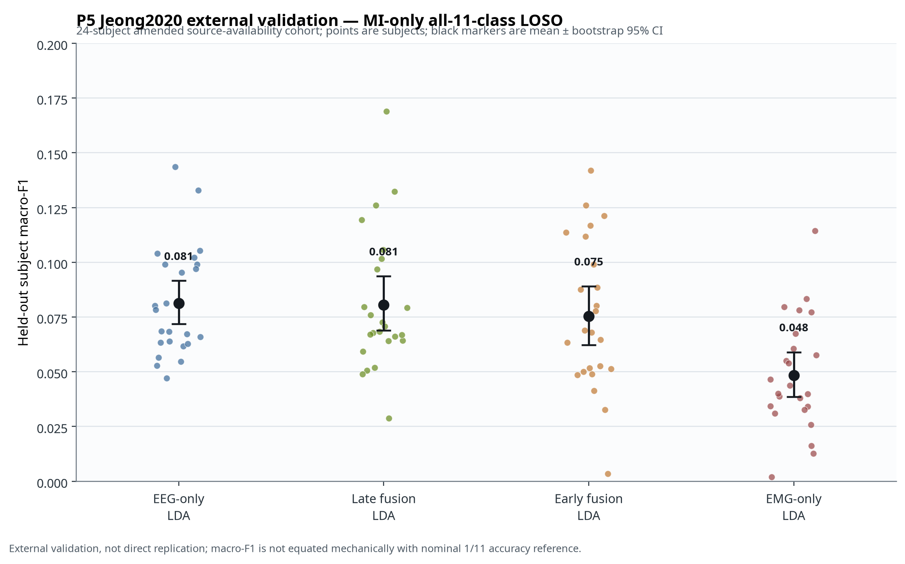

# V2 P5 Jeong2020 External Validation Audit — Recovery R2

**Study ID:** `nemar-nm000311-jeong-p5-external-loso-24subject-r2`  
**Evidence tier:** V2 Recovery R2; external validation; `direct_replication: false`  
**Status:** **Completed, D1–D5 passed, independently rerun with exact subject-level agreement.**

## Scope and Identity

This audit records a new, protocol-locked external evaluation using NEMAR `nm000311` v1.0.2, sourced from the Jeong2020 multimodal dataset. It is **not** a direct replication of the frozen Cho2017 primary P5 evidence and must not be pooled or numerically ranked against it. The analysis is restricted to `ses-0`, motor imagery (MI), three task runs, all eleven movement labels, and strict leave-one-subject-out (LOSO) inference.

The programme first stopped the original 25-subject plan because NEMAR did not expose the twist run for `sub-23`. An independent check of the original GigaDB record and author-attributed Zenodo repackage verified that `session1_sub23_twist_MI` is unavailable through the checked individually retrievable sources. The amended cohort contains the other 24 predeclared subjects. This was determined before any R2 feature extraction or model fitting. The source check, demographic balance record, and amendments are linked below.

| Audit element | Artefact |
|---|---|
| Source-availability verification | `audit/V2_P5_SUB23_SECOND_SOURCE_CHECK.md` |
| Cohort amendment and balance check | `audit/V2_PROTOCOL_AMENDMENT_RECOVERY_R2_001.md`; `audit/v2_p5_jeong_24subject_demographic_balance.json` |
| Event-cap amendment | `audit/V2_PROTOCOL_AMENDMENT_RECOVERY_R2_002.md` |
| Immutable execution configuration | `configs/experiments/v2_p5_jeong_recovery_r2.json` |
| Primary result directory | `results/real/v2-recovery-r2/nemar-nm000311-jeong-p5-external-loso-24subject-r2/` |
| Independent rerun directory | `results/real/v2-recovery-r2-independent-rerun/nemar-nm000311-jeong-p5-external-loso-24subject-r2/` |

## Data and Protocol Boundary

The retained cohort comprises `sub-1`–`sub-22`, `sub-24`, and `sub-25`. Each subject contributes 550 MI trials: 50 per label for six reaches, three grasp types, and two wrist twists. `sub-14` and `sub-16` had extra `grasp_cup` event rows in the official sidecars; the pre-execution amendment retained the first 50 valid rows in original TSV order for every label. No signal, prediction, score, or model output informed this rule.

The cache stores fixed epoch-local features only: 60 EEG channels represented by 8–12 Hz and 13–30 Hz log-power summaries (120 features), and seven EMG channels represented by mean absolute value, RMS, and waveform length (21 features). Four EOG channels are excluded by exact name. All BDF/TSV inputs were downloaded sequentially outside the repository, content-length and SHA-256 receipted, then deleted after cache extraction.

| Gate | Result | Evidence |
|---|---|---|
| D1 file integrity | Pass | 48 derived cache/provenance observations; checksum recomputation; no retained BDF/EDF/GDF/VHDR/EEG files in cache |
| D2 schema | Pass | Every subject: EEG `(550, 120)`, EMG `(550, 21)`, labels `(550,)`, 60 EEG, 7 EMG, 1000 Hz |
| D3 labels | Pass | All 24 retained subjects contain exactly the same 11 labels, with 50 retained trials per class |
| D4 protocol | Pass | MI-only `ses-0`, all three runs, predeclared 24-subject LOSO, no target calibration, fixed transparent model list |
| D5 leakage audit | Pass | Held-out subject excluded from scalers and all fitted classifiers; no target selection/adaptation; late fusion uses training-fold models only |

## Model Conditions and Statistical Plan

Four predeclared transparent conditions were fit independently in each LOSO fold: EEG-only LDA, EMG-only LDA, early feature-concatenation LDA, and late arithmetic-mean probability LDA. Scalers and LDA models were fit only on the 23 training subjects in each fold. The primary endpoint is held-out-subject macro-F1. Accuracy and balanced accuracy are secondary outputs and are not substituted for macro-F1.

The inference unit is the subject (`n=24`). The analysis used 10,000-resample percentile bootstrap confidence intervals for mean macro-F1, a four-condition Friedman test, six two-sided paired Wilcoxon tests, and Holm adjustment across the entire pairwise family. Because each retained test subject has exactly balanced eleven-class labels, **1/11 ≈ 0.0909** is a nominal uniform-class reference for accuracy and balanced accuracy. It is not a formal chance test for macro-F1, whose finite-sample expectation is not mechanically interchangeable with that reference.

## Results

| Condition | Mean macro-F1 | SD | Bootstrap 95% CI for mean | Median | Mean accuracy / balanced accuracy |
|---|---:|---:|---:|---:|---:|
| EEG-only LDA | 0.0813 | 0.0252 | 0.0719–0.0915 | 0.0734 | 0.1142 / 0.1142 |
| EMG-only LDA | 0.0484 | 0.0257 | 0.0386–0.0590 | 0.0419 | 0.0954 / 0.0954 |
| Early-fusion LDA | 0.0754 | 0.0341 | 0.0622–0.0890 | 0.0684 | 0.1133 / 0.1133 |
| Late-fusion LDA | 0.0805 | 0.0315 | 0.0689–0.0936 | 0.0696 | 0.1127 / 0.1127 |

The omnibus model comparison is non-null (**Friedman χ²(3)=16.25, p=0.00101**). Within the locked six-comparison family, EEG-only exceeds EMG-only (mean paired macro-F1 difference 0.0328; Holm-adjusted p=0.00103), late fusion exceeds EMG-only (difference 0.0321; Holm-adjusted p=0.000762), and early fusion exceeds EMG-only (difference 0.0270; Holm-adjusted p=0.00800). No contrast among EEG-only, early fusion, and late fusion survives Holm adjustment (all adjusted p=1.0).

> **Interpretation boundary.** In this amended Jeong MI-only external cohort and these fixed transparent LDA pipelines, EMG-only is lower than the three other conditions, whereas neither transparent fusion rule establishes a Holm-supported advantage over EEG-only. This is neither a general statement that fusion fails nor a causal explanation of modality performance. In particular, it does not establish whether the result reflects imagery strategy, residual microactivation, sensor placement, source preprocessing, feature choices, or any other mechanism.

## Figure



The figure displays each held-out subject and the bootstrap interval for the condition mean. It is generated deterministically from `subject_level_results.csv` and `statistics_macro_f1.json` by `scripts/plot_p5_r2_external_validation.py`. It is a within-Jeong visualization only.

## Reproducibility and Integrity

The primary and independent-rerun `subject_level_results.csv` files each contain 96 rows (24 subjects × 4 models), are byte-identical, and share SHA-256:

```text
a35b1cb5daa2cdae2078e7668eb1b028e4613c99e062df2b941183c7b971e36b
```

The protocol and manifest files are also exact matches between result namespaces. This independent execution check confirms deterministic reproducibility for the recorded environment and cache; it is not an additional biological sample or a new inferential replicate.

## Constraints on Use

No deep fusion, target calibration, hyperparameter search, or missing-modality synthetic stress analysis was added. The frozen Cho2017 result remains the primary P5 evidence. Jeong R2 may be cited only as an **amended 24-subject external validation** with the stated MI-only, all-11-class, feature/pipeline, and source-availability boundaries.

## References

[1] [NEMAR dataset nm000311](https://doi.org/10.82901/nemar.nm000311)  
[2] [GigaDB supporting data 100788](https://doi.org/10.5524/100788)  
[3] [Jeong et al., *GigaScience* (2020)](https://doi.org/10.1093/gigascience/giaa098)  
[4] [Zenodo author-attributed repackage, record 19021437](https://doi.org/10.5281/zenodo.19021437)
