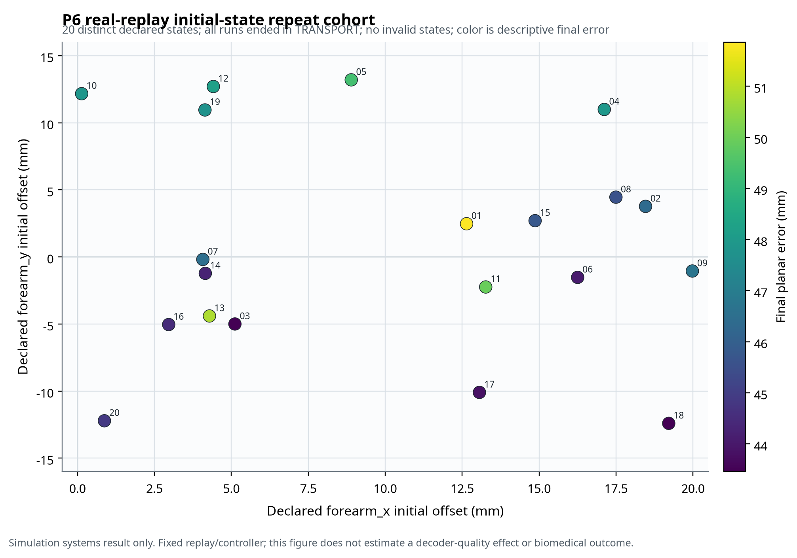

# V2 P6 Real-Replay Initial-State Repeat Audit — Recovery R2

**Protocol ID:** `p6-real-replay-initial-state-repeats-recovery-r2`  
**Evidence tier:** V2 Recovery R2 systems evidence; `origin=real_replay_initial_state_variation`; `benchmark_eligible=false`.  
**Status:** **Completed, 20 declared initial-state realizations, independently rerun with exact run-record agreement.**

## Scope and Evidence Boundary

This study reopens P6 only after the R1 capability hard stop and the R2 pre-execution amendment. It holds the recorded CSV replay, decoder-output stream, controller policy, command mapping, task geometry, target, object state, task success rule, and timing fixed. It varies only a declared, seed-linked physical initial state in the MyoSim pick-place simulator.

The frozen V1.1 real replay-only evidence remains historical and is not overwritten. The frozen synthetic controlled-corruption sweep remains separate and retains `origin=synthetic_controlled_corruption` and `benchmark_eligible=false`. The current cohort is neither synthetic decoder corruption nor biomedical validation. It must not be pooled with either older source.

| Item | Locked value |
|---|---|
| Replay input | `pick_place_replay.csv`; SHA-256 `a94e59e30e2599eb92517198739dff96aa40b01f3bf6777756722e09960e09f3` |
| Task | Fixed MyoSim MuJoCo pick-place task |
| Decoder/control | Fixed recorded replay and fixed V1.1 controller configuration |
| Variation | `uniform_forearm_xy_v1` initial qpos offsets only |
| `forearm_x` range | Uniform [0.000, 0.020] m |
| `forearm_y` range | Uniform [−0.015, +0.015] m |
| Cohort | 20 predeclared seeds `20260901`–`20260920` |
| Primary artefact | `results/real/v2-recovery-r2/p6_real_replay_initial_state_repeats_r2/` |
| Independent rerun | `results/real/v2-recovery-r2-independent-rerun/p6_real_replay_initial_state_repeats_r2/` |

## Gate Sequence

The unperturbed benchmark endpoint first matched the preserved MyoSim benchmark exactly, both before and after the minimal extension. The declared-state preflight then confirmed that seeds `20260901` and `20260902` generated distinct actual qpos vectors, retained all undeclared named joints at reset values, stayed inside the configured ranges, and produced no invalid state. The early probe outcomes were preserved but did not change the range, seed set, or study design.

| Gate | Result | Supporting artefact |
|---|---|---|
| Historical baseline compatibility | Pass | `V2_P6_UNPERTURBED_BASELINE_MATCH_RECOVERY_R2.md` |
| Post-patch unperturbed compatibility | Pass | `audit/v2r2_p6_postpatch_baseline.log` |
| New capability tests | Pass | Three MyoSim integration tests passed: inert default, two distinct bounded states, original benchmark |
| Declared-state probe | Pass | `V2_P6_INITIAL_STATE_CAPABILITY_PREFLIGHT_RECOVERY_R2.md` |
| 20-run completeness | Pass | 20 seeds, 20 run artefacts, 20 distinct qpos vectors |
| Range/identity validation | Pass | Every run records replay SHA, configured ranges, realized offsets, seed, state summary, and task/control result |
| Invalid-state condition | Pass | 0 invalid states |
| Independent execution rerun | Pass | Primary and rerun `run_records.json` are byte-identical; code fingerprint matches; protocol differs only by mode label |

## Results

All 20 realized initial states were distinct. The observed `forearm_x` offsets ranged from 0.000136 to 0.019980 m (mean 0.010071 m; bootstrap 95% CI for mean 0.007134–0.012944 m). The observed `forearm_y` offsets ranged from −0.012405 to 0.013199 m (mean 0.000901 m; bootstrap 95% CI −0.002497 to 0.004350 m). No initial velocities were added and no undeclared joint positions were changed.

| Endpoint | Result |
|---|---|
| Task success | 0/20; 0.000; Wilson 95% CI 0.000–0.161 |
| Task failure | 20/20; 1.000; Wilson 95% CI 0.839–1.000 |
| Final state | `TRANSPORT` in 20/20 runs |
| Completion time among successful runs | Undefined: no successful run |
| Final planar error | Mean 0.046650 m; SD 0.002513 m; bootstrap 95% CI for mean 0.045621–0.047751 m |
| Path length | Mean 1.024690 m; SD 0.041596 m; bootstrap 95% CI for mean 1.007466–1.042456 m |
| Grasp stability steps | Mean 15.15; range 15–16 |
| Command corrections | 3.0 in every run |
| Invalid states | 0/20 |

> **Interpretation boundary.** Under the declared simulator-only distribution, the fixed replay/controller sequence did not complete the task for any of the 20 perturbed initial states, while the single compatibility baseline completed its fixed unperturbed state. This is a negative systems finding about the *specified simulator initial-state distribution*. It does not estimate human performance, does not prove a clinical robustness threshold, does not identify a physical mechanism, and does not establish a decoder-quality dose response.

No post hoc tuning was performed. The predeclared range, seed list, task, replay, policy, and endpoints were retained despite the all-failure result. The result therefore makes visible a control-margin limitation under this simulation perturbation rather than hiding it through seed selection or scenario revision.

## Figure



The deterministic figure plots the 20 recorded initial forearm offsets in millimetres and uses colour only for the recorded final planar error. It shows the declared state coverage and does not encode a decoder-quality effect, causal relationship, or biomedical outcome.

## Statistical and Reproducibility Notes

The success and failure proportions use Wilson 95% intervals. Continuous endpoint intervals use 10,000-resample percentile bootstrap intervals across the 20 declared initial-state realizations. The baseline is a compatibility control, not a random comparator cohort, so no baseline-versus-cohort hypothesis test was conducted. Because the decoder replay is fixed in every run, no association or dose-response analysis with decoder quality is identified by this design.

The primary and rerun `run_records.json` artifacts are exact matches. The independent run regenerates the same seed-to-offset mapping, distinct state set, failure states, final errors, and task metrics. This establishes deterministic reproducibility of the declared simulation experiment; it is not a second inferential cohort.

## Reproduction

```bash
PYTHONPATH=<LOCAL_WORKSPACE>/dependencies/myosim_v1_1/src \
python3 scripts/run_p6_initial_state_repeats_r2.py \
  --mode primary --seeds $(seq 20260901 20260920) \
  --output results/real/v2-recovery-r2/p6_real_replay_initial_state_repeats_r2

PYTHONPATH=<LOCAL_WORKSPACE>/dependencies/myosim_v1_1/src \
python3 scripts/analyze_p6_initial_state_repeats_r2.py \
  results/real/v2-recovery-r2/p6_real_replay_initial_state_repeats_r2
```

The source extension is deliberately limited to explicit initial-state configuration, bounded named-joint reset offsets, and per-run state recording. It must not be used to relabel the synthetic corruption study or reinterpret a simulation result as biomedical evidence.
