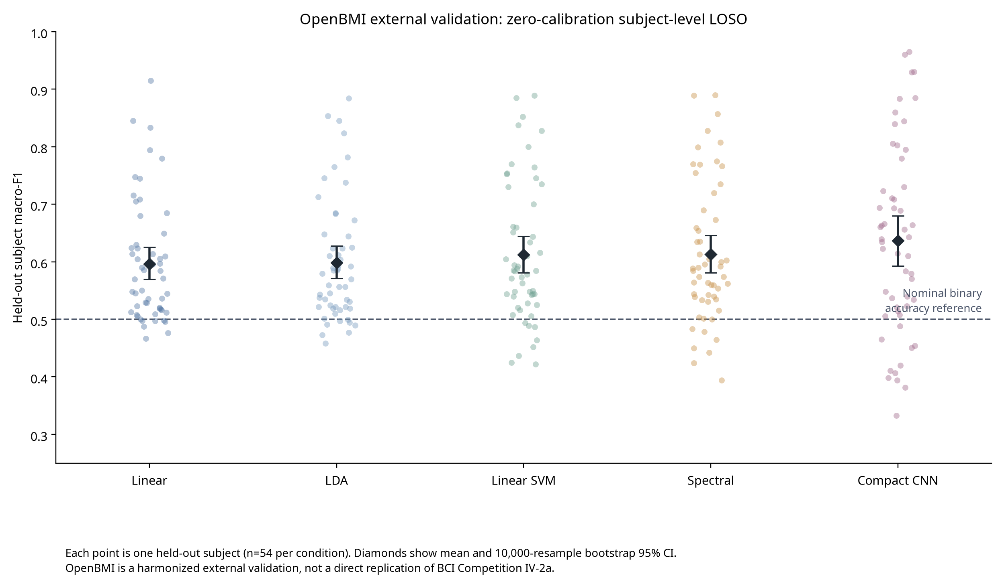

# P4 Appendix — V2 Recovery R3 Q1 Standard

## A. Scope and Evidence Boundary

P4 is a 54-subject external binary-MI validation. It is not a direct numerical replication of BCI IV-2a and its pairwise testing is within OpenBMI only.

This appendix is rendered from the locked primary artefacts. It does not rerun a model, modify a cohort, or calculate a new result. The primary and independent rerun are separate reproducibility executions, not pooled evidence.

## B. Protocol, Validation, and Reproducibility Record

| Gate | Status | Failure count | Failure detail |
|---|---|---|---|
| D1_file_integrity | pass | 0 | — |
| D2_schema | pass | 0 | — |
| D3_labels | pass | 0 | — |
| D4_protocol | pass | 0 | — |
| D5_leakage_audit | pass | 0 | — |

| Artefact | Primary location | Rerun / check |
|---|---|---|
| Protocol | `protocol.json` | Protocol ID: `p4-openbmi-harmonized-zero-calibration-loso-recovery-r1` |
| Manifest | `manifest.json` | Manifest ID: `nemar-nm000338-openbmi-v2-recovery-r1` |
| Environment | `environment.json` | Captured with primary execution |
| Results | `subject_level_results.csv` | 270 observations; rerun at `results/real/v2-recovery-r1-independent-rerun/nemar-nm000338-openbmi-p4-external-loso-recovery-r1` |
| Statistics | `statistics_macro_f1.json` | subject is the inference unit |

## C. Full Subject-Level Result Table

| Subject | Condition | Fold | Seed | Macro-F1 | Accuracy | Balanced accuracy |
|---|---|---|---|---|---|---|
| sub-1 | Linear | 0 | 20260823 | 0.613900 | 0.640000 | 0.640000 |
| sub-1 | LDA | 0 | 20260824 | 0.611692 | 0.635000 | 0.635000 |
| sub-1 | Spectral | 0 | 20260825 | 0.559023 | 0.610000 | 0.610000 |
| sub-1 | Linear SVM | 0 | 20260826 | 0.544160 | 0.600000 | 0.600000 |
| sub-1 | Compact CNN | 0 | 20260827 | 0.639699 | 0.670000 | 0.670000 |
| sub-2 | Linear | 1 | 20260924 | 0.623409 | 0.625000 | 0.625000 |
| sub-2 | LDA | 1 | 20260925 | 0.594156 | 0.600000 | 0.600000 |
| sub-2 | Spectral | 1 | 20260926 | 0.634740 | 0.640000 | 0.640000 |
| sub-2 | Linear SVM | 1 | 20260927 | 0.633811 | 0.640000 | 0.640000 |
| sub-2 | Compact CNN | 1 | 20260928 | 0.410658 | 0.530000 | 0.530000 |
| sub-3 | Linear | 2 | 20261025 | 0.745002 | 0.750000 | 0.750000 |
| sub-3 | LDA | 2 | 20261026 | 0.781587 | 0.785000 | 0.785000 |
| sub-3 | Spectral | 2 | 20261027 | 0.807224 | 0.810000 | 0.810000 |
| sub-3 | Linear SVM | 2 | 20261028 | 0.827516 | 0.830000 | 0.830000 |
| sub-3 | Compact CNN | 2 | 20261029 | 0.779802 | 0.780000 | 0.780000 |
| sub-4 | Linear | 3 | 20261126 | 0.535228 | 0.545000 | 0.545000 |
| sub-4 | LDA | 3 | 20261127 | 0.556356 | 0.575000 | 0.575000 |
| sub-4 | Spectral | 3 | 20261128 | 0.539263 | 0.540000 | 0.540000 |
| sub-4 | Linear SVM | 3 | 20261129 | 0.543619 | 0.545000 | 0.545000 |
| sub-4 | Compact CNN | 3 | 20261130 | 0.406717 | 0.535000 | 0.535000 |
| sub-5 | Linear | 4 | 20261227 | 0.684992 | 0.685000 | 0.685000 |
| sub-5 | LDA | 4 | 20261228 | 0.672040 | 0.675000 | 0.675000 |
| sub-5 | Spectral | 4 | 20261229 | 0.719888 | 0.720000 | 0.720000 |
| sub-5 | Linear SVM | 4 | 20261230 | 0.729973 | 0.730000 | 0.730000 |
| sub-5 | Compact CNN | 4 | 20261231 | 0.859944 | 0.860000 | 0.860000 |
| sub-6 | Linear | 5 | 20261328 | 0.604302 | 0.610000 | 0.610000 |
| sub-6 | LDA | 5 | 20261329 | 0.623409 | 0.625000 | 0.625000 |
| sub-6 | Spectral | 5 | 20261330 | 0.673162 | 0.675000 | 0.675000 |
| sub-6 | Linear SVM | 5 | 20261331 | 0.651154 | 0.655000 | 0.655000 |
| sub-6 | Compact CNN | 5 | 20261332 | 0.730094 | 0.745000 | 0.745000 |
| sub-7 | Linear | 6 | 20261429 | 0.517460 | 0.525000 | 0.525000 |
| sub-7 | LDA | 6 | 20261430 | 0.521543 | 0.525000 | 0.525000 |
| sub-7 | Spectral | 6 | 20261431 | 0.503498 | 0.505000 | 0.505000 |
| sub-7 | Linear SVM | 6 | 20261432 | 0.493975 | 0.495000 | 0.495000 |
| sub-7 | Compact CNN | 6 | 20261433 | 0.514307 | 0.540000 | 0.540000 |
| sub-8 | Linear | 7 | 20261530 | 0.590164 | 0.610000 | 0.610000 |
| sub-8 | LDA | 7 | 20261531 | 0.604167 | 0.620000 | 0.620000 |
| sub-8 | Spectral | 7 | 20261532 | 0.590120 | 0.620000 | 0.620000 |
| sub-8 | Linear SVM | 7 | 20261533 | 0.583502 | 0.615000 | 0.615000 |
| sub-8 | Compact CNN | 7 | 20261534 | 0.534489 | 0.575000 | 0.575000 |
| sub-9 | Linear | 8 | 20261631 | 0.779449 | 0.780000 | 0.780000 |
| sub-9 | LDA | 8 | 20261632 | 0.764712 | 0.765000 | 0.765000 |
| sub-9 | Spectral | 8 | 20261633 | 0.604396 | 0.640000 | 0.640000 |
| sub-9 | Linear SVM | 8 | 20261634 | 0.604396 | 0.640000 | 0.640000 |
| sub-9 | Compact CNN | 8 | 20261635 | 0.839744 | 0.840000 | 0.840000 |
| sub-10 | Linear | 9 | 20261732 | 0.497813 | 0.515000 | 0.515000 |
| sub-10 | LDA | 9 | 20261733 | 0.545267 | 0.560000 | 0.560000 |
| sub-10 | Spectral | 9 | 20261734 | 0.533279 | 0.540000 | 0.540000 |
| sub-10 | Linear SVM | 9 | 20261735 | 0.516182 | 0.525000 | 0.525000 |
| sub-10 | Compact CNN | 9 | 20261736 | 0.539573 | 0.565000 | 0.565000 |
| sub-11 | Linear | 10 | 20261833 | 0.508772 | 0.510000 | 0.510000 |
| sub-11 | LDA | 10 | 20261834 | 0.499199 | 0.500000 | 0.500000 |
| sub-11 | Spectral | 10 | 20261835 | 0.464646 | 0.470000 | 0.470000 |
| sub-11 | Linear SVM | 10 | 20261836 | 0.463508 | 0.470000 | 0.470000 |
| sub-11 | Compact CNN | 10 | 20261837 | 0.454081 | 0.535000 | 0.535000 |
| sub-12 | Linear | 11 | 20261934 | 0.544715 | 0.545000 | 0.545000 |
| sub-12 | LDA | 11 | 20261935 | 0.559604 | 0.560000 | 0.560000 |
| sub-12 | Spectral | 11 | 20261936 | 0.563154 | 0.565000 | 0.565000 |
| sub-12 | Linear SVM | 11 | 20261937 | 0.539816 | 0.540000 | 0.540000 |
| sub-12 | Compact CNN | 11 | 20261938 | 0.420181 | 0.535000 | 0.535000 |
| sub-13 | Linear | 12 | 20262035 | 0.529412 | 0.540000 | 0.540000 |
| sub-13 | LDA | 12 | 20262036 | 0.524703 | 0.525000 | 0.525000 |
| sub-13 | Spectral | 12 | 20262037 | 0.602203 | 0.610000 | 0.610000 |
| sub-13 | Linear SVM | 12 | 20262038 | 0.592003 | 0.600000 | 0.600000 |
| sub-13 | Compact CNN | 12 | 20262039 | 0.488095 | 0.570000 | 0.570000 |
| sub-14 | Linear | 13 | 20262136 | 0.497126 | 0.510000 | 0.510000 |
| sub-14 | LDA | 13 | 20262137 | 0.497235 | 0.525000 | 0.525000 |
| sub-14 | Spectral | 13 | 20262138 | 0.515659 | 0.555000 | 0.555000 |
| sub-14 | Linear SVM | 13 | 20262139 | 0.528100 | 0.560000 | 0.560000 |
| sub-14 | Compact CNN | 13 | 20262140 | 0.642707 | 0.660000 | 0.660000 |
| sub-15 | Linear | 14 | 20262237 | 0.495586 | 0.520000 | 0.520000 |
| sub-15 | LDA | 14 | 20262238 | 0.457905 | 0.510000 | 0.510000 |
| sub-15 | Spectral | 14 | 20262239 | 0.393939 | 0.400000 | 0.400000 |
| sub-15 | Linear SVM | 14 | 20262240 | 0.424986 | 0.425000 | 0.425000 |
| sub-15 | Compact CNN | 14 | 20262241 | 0.332897 | 0.465000 | 0.465000 |
| sub-16 | Linear | 15 | 20262338 | 0.528822 | 0.530000 | 0.530000 |
| sub-16 | LDA | 15 | 20262339 | 0.534056 | 0.535000 | 0.535000 |
| sub-16 | Spectral | 15 | 20262340 | 0.599640 | 0.600000 | 0.600000 |
| sub-16 | Linear SVM | 15 | 20262341 | 0.609961 | 0.610000 | 0.610000 |
| sub-16 | Compact CNN | 15 | 20262342 | 0.660510 | 0.665000 | 0.665000 |
| sub-17 | Linear | 16 | 20262439 | 0.609375 | 0.610000 | 0.610000 |
| sub-17 | LDA | 16 | 20262440 | 0.589343 | 0.590000 | 0.590000 |
| sub-17 | Spectral | 16 | 20262441 | 0.774949 | 0.775000 | 0.775000 |
| sub-17 | Linear SVM | 16 | 20262442 | 0.769908 | 0.770000 | 0.770000 |
| sub-17 | Compact CNN | 16 | 20262443 | 0.693275 | 0.695000 | 0.695000 |
| sub-18 | Linear | 17 | 20262540 | 0.747475 | 0.750000 | 0.750000 |
| sub-18 | LDA | 17 | 20262541 | 0.745702 | 0.750000 | 0.750000 |
| sub-18 | Spectral | 17 | 20262542 | 0.734920 | 0.745000 | 0.745000 |
| sub-18 | Linear SVM | 17 | 20262543 | 0.734920 | 0.745000 | 0.745000 |
| sub-18 | Compact CNN | 17 | 20262544 | 0.884651 | 0.885000 | 0.885000 |
| sub-19 | Linear | 18 | 20262641 | 0.708333 | 0.720000 | 0.720000 |
| sub-19 | LDA | 18 | 20262642 | 0.712644 | 0.720000 | 0.720000 |
| sub-19 | Spectral | 18 | 20262643 | 0.766046 | 0.770000 | 0.770000 |
| sub-19 | Linear SVM | 18 | 20262644 | 0.745702 | 0.750000 | 0.750000 |
| sub-19 | Compact CNN | 18 | 20262645 | 0.723375 | 0.735000 | 0.735000 |
| sub-20 | Linear | 19 | 20262742 | 0.585859 | 0.590000 | 0.590000 |
| sub-20 | LDA | 19 | 20262743 | 0.588096 | 0.600000 | 0.600000 |
| sub-20 | Spectral | 19 | 20262744 | 0.634991 | 0.635000 | 0.635000 |
| sub-20 | Linear SVM | 19 | 20262745 | 0.643923 | 0.645000 | 0.645000 |
| sub-20 | Compact CNN | 19 | 20262746 | 0.693706 | 0.695000 | 0.695000 |
| sub-21 | Linear | 20 | 20262843 | 0.833161 | 0.835000 | 0.835000 |
| sub-21 | LDA | 20 | 20262844 | 0.853384 | 0.855000 | 0.855000 |
| sub-21 | Spectral | 20 | 20262845 | 0.857201 | 0.860000 | 0.860000 |
| sub-21 | Linear SVM | 20 | 20262846 | 0.851886 | 0.855000 | 0.855000 |
| sub-21 | Compact CNN | 20 | 20262847 | 0.883459 | 0.885000 | 0.885000 |
| sub-22 | Linear | 21 | 20262944 | 0.571000 | 0.600000 | 0.600000 |
| sub-22 | LDA | 21 | 20262945 | 0.585108 | 0.620000 | 0.620000 |
| sub-22 | Spectral | 21 | 20262946 | 0.658667 | 0.680000 | 0.680000 |
| sub-22 | Linear SVM | 21 | 20262947 | 0.661208 | 0.685000 | 0.685000 |
| sub-22 | Compact CNN | 21 | 20262948 | 0.548003 | 0.615000 | 0.615000 |
| sub-23 | Linear | 22 | 20263045 | 0.623862 | 0.625000 | 0.625000 |
| sub-23 | LDA | 22 | 20263046 | 0.647746 | 0.650000 | 0.650000 |
| sub-23 | Spectral | 22 | 20263047 | 0.530516 | 0.570000 | 0.570000 |
| sub-23 | Linear SVM | 22 | 20263048 | 0.520384 | 0.565000 | 0.565000 |
| sub-23 | Compact CNN | 22 | 20263049 | 0.665904 | 0.675000 | 0.675000 |
| sub-24 | Linear | 23 | 20263146 | 0.499671 | 0.525000 | 0.525000 |
| sub-24 | LDA | 23 | 20263147 | 0.490676 | 0.535000 | 0.535000 |
| sub-24 | Spectral | 23 | 20263148 | 0.483258 | 0.500000 | 0.500000 |
| sub-24 | Linear SVM | 23 | 20263149 | 0.486864 | 0.500000 | 0.500000 |
| sub-24 | Compact CNN | 23 | 20263150 | 0.393959 | 0.525000 | 0.525000 |
| sub-25 | Linear | 24 | 20263247 | 0.497538 | 0.500000 | 0.500000 |
| sub-25 | LDA | 24 | 20263248 | 0.494369 | 0.505000 | 0.505000 |
| sub-25 | Spectral | 24 | 20263249 | 0.584158 | 0.585000 | 0.585000 |
| sub-25 | Linear SVM | 24 | 20263250 | 0.584491 | 0.585000 | 0.585000 |
| sub-25 | Compact CNN | 24 | 20263251 | 0.450678 | 0.530000 | 0.530000 |
| sub-26 | Linear | 25 | 20263348 | 0.523133 | 0.530000 | 0.530000 |
| sub-26 | LDA | 25 | 20263349 | 0.518521 | 0.535000 | 0.535000 |
| sub-26 | Spectral | 25 | 20263350 | 0.553650 | 0.555000 | 0.555000 |
| sub-26 | Linear SVM | 25 | 20263351 | 0.548374 | 0.550000 | 0.550000 |
| sub-26 | Compact CNN | 25 | 20263352 | 0.398119 | 0.520000 | 0.520000 |
| sub-27 | Linear | 26 | 20263449 | 0.536244 | 0.540000 | 0.540000 |
| sub-27 | LDA | 26 | 20263450 | 0.534709 | 0.535000 | 0.535000 |
| sub-27 | Spectral | 26 | 20263451 | 0.539701 | 0.560000 | 0.560000 |
| sub-27 | Linear SVM | 26 | 20263452 | 0.547805 | 0.565000 | 0.565000 |
| sub-27 | Compact CNN | 26 | 20263453 | 0.579776 | 0.605000 | 0.605000 |
| sub-28 | Linear | 27 | 20263550 | 0.715187 | 0.720000 | 0.720000 |
| sub-28 | LDA | 27 | 20263551 | 0.737374 | 0.740000 | 0.740000 |
| sub-28 | Spectral | 27 | 20263552 | 0.754257 | 0.755000 | 0.755000 |
| sub-28 | Linear SVM | 27 | 20263553 | 0.753614 | 0.755000 | 0.755000 |
| sub-28 | Compact CNN | 27 | 20263554 | 0.929825 | 0.930000 | 0.930000 |
| sub-29 | Linear | 28 | 20263651 | 0.794378 | 0.795000 | 0.795000 |
| sub-29 | LDA | 28 | 20263652 | 0.823726 | 0.825000 | 0.825000 |
| sub-29 | Spectral | 28 | 20263653 | 0.827918 | 0.830000 | 0.830000 |
| sub-29 | Linear SVM | 28 | 20263654 | 0.837662 | 0.840000 | 0.840000 |
| sub-29 | Compact CNN | 28 | 20263655 | 0.655836 | 0.660000 | 0.660000 |
| sub-30 | Linear | 29 | 20263752 | 0.629667 | 0.630000 | 0.630000 |
| sub-30 | LDA | 29 | 20263753 | 0.579832 | 0.580000 | 0.580000 |
| sub-30 | Spectral | 29 | 20263754 | 0.689876 | 0.690000 | 0.690000 |
| sub-30 | Linear SVM | 29 | 20263755 | 0.699880 | 0.700000 | 0.700000 |
| sub-30 | Compact CNN | 29 | 20263756 | 0.634834 | 0.655000 | 0.655000 |
| sub-31 | Linear | 30 | 20263853 | 0.584491 | 0.585000 | 0.585000 |
| sub-31 | LDA | 30 | 20263854 | 0.584990 | 0.585000 | 0.585000 |
| sub-31 | Spectral | 30 | 20263855 | 0.595394 | 0.610000 | 0.610000 |
| sub-31 | Linear SVM | 30 | 20263856 | 0.587672 | 0.605000 | 0.605000 |
| sub-31 | Compact CNN | 30 | 20263857 | 0.688764 | 0.700000 | 0.700000 |
| sub-32 | Linear | 31 | 20263954 | 0.649524 | 0.655000 | 0.655000 |
| sub-32 | LDA | 31 | 20263955 | 0.644101 | 0.655000 | 0.655000 |
| sub-32 | Spectral | 31 | 20263956 | 0.769424 | 0.770000 | 0.770000 |
| sub-32 | Linear SVM | 31 | 20263957 | 0.764287 | 0.765000 | 0.765000 |
| sub-32 | Compact CNN | 31 | 20263958 | 0.794954 | 0.795000 | 0.795000 |
| sub-33 | Linear | 32 | 20264055 | 0.704900 | 0.715000 | 0.715000 |
| sub-33 | LDA | 32 | 20264056 | 0.683244 | 0.700000 | 0.700000 |
| sub-33 | Spectral | 32 | 20264057 | 0.798839 | 0.805000 | 0.805000 |
| sub-33 | Linear SVM | 32 | 20264058 | 0.799543 | 0.805000 | 0.805000 |
| sub-33 | Compact CNN | 32 | 20264059 | 0.929747 | 0.930000 | 0.930000 |
| sub-34 | Linear | 33 | 20264156 | 0.547937 | 0.555000 | 0.555000 |
| sub-34 | LDA | 33 | 20264157 | 0.530804 | 0.540000 | 0.540000 |
| sub-34 | Spectral | 33 | 20264158 | 0.560151 | 0.565000 | 0.565000 |
| sub-34 | Linear SVM | 33 | 20264159 | 0.571129 | 0.575000 | 0.575000 |
| sub-34 | Compact CNN | 33 | 20264160 | 0.523133 | 0.530000 | 0.530000 |
| sub-35 | Linear | 34 | 20264257 | 0.487307 | 0.535000 | 0.535000 |
| sub-35 | LDA | 34 | 20264258 | 0.489796 | 0.490000 | 0.490000 |
| sub-35 | Spectral | 34 | 20264259 | 0.542264 | 0.550000 | 0.550000 |
| sub-35 | Linear SVM | 34 | 20264260 | 0.542264 | 0.550000 | 0.550000 |
| sub-35 | Compact CNN | 34 | 20264261 | 0.614505 | 0.625000 | 0.625000 |
| sub-36 | Linear | 35 | 20264358 | 0.914828 | 0.915000 | 0.915000 |
| sub-36 | LDA | 35 | 20264359 | 0.884349 | 0.885000 | 0.885000 |
| sub-36 | Spectral | 35 | 20264360 | 0.888889 | 0.890000 | 0.890000 |
| sub-36 | Linear SVM | 35 | 20264361 | 0.888889 | 0.890000 | 0.890000 |
| sub-36 | Compact CNN | 35 | 20264362 | 0.959936 | 0.960000 | 0.960000 |
| sub-37 | Linear | 36 | 20264459 | 0.844903 | 0.845000 | 0.845000 |
| sub-37 | LDA | 36 | 20264460 | 0.844810 | 0.845000 | 0.845000 |
| sub-37 | Spectral | 36 | 20264461 | 0.889901 | 0.890000 | 0.890000 |
| sub-37 | Linear SVM | 36 | 20264462 | 0.884928 | 0.885000 | 0.885000 |
| sub-37 | Compact CNN | 36 | 20264463 | 0.964992 | 0.965000 | 0.965000 |
| sub-38 | Linear | 37 | 20264560 | 0.507587 | 0.510000 | 0.510000 |
| sub-38 | LDA | 37 | 20264561 | 0.521543 | 0.525000 | 0.525000 |
| sub-38 | Spectral | 37 | 20264562 | 0.478098 | 0.485000 | 0.485000 |
| sub-38 | Linear SVM | 37 | 20264563 | 0.488722 | 0.490000 | 0.490000 |
| sub-38 | Compact CNN | 37 | 20264564 | 0.381200 | 0.515000 | 0.515000 |
| sub-39 | Linear | 38 | 20264661 | 0.613366 | 0.615000 | 0.615000 |
| sub-39 | LDA | 38 | 20264662 | 0.623640 | 0.630000 | 0.630000 |
| sub-39 | Spectral | 38 | 20264663 | 0.654300 | 0.655000 | 0.655000 |
| sub-39 | Linear SVM | 38 | 20264664 | 0.659455 | 0.660000 | 0.660000 |
| sub-39 | Compact CNN | 38 | 20264665 | 0.844123 | 0.845000 | 0.845000 |
| sub-40 | Linear | 39 | 20264762 | 0.511885 | 0.540000 | 0.540000 |
| sub-40 | LDA | 39 | 20264763 | 0.515945 | 0.545000 | 0.545000 |
| sub-40 | Spectral | 39 | 20264764 | 0.424000 | 0.505000 | 0.505000 |
| sub-40 | Linear SVM | 39 | 20264765 | 0.422102 | 0.510000 | 0.510000 |
| sub-40 | Compact CNN | 39 | 20264766 | 0.537037 | 0.540000 | 0.540000 |
| sub-41 | Linear | 40 | 20264863 | 0.518634 | 0.525000 | 0.525000 |
| sub-41 | LDA | 40 | 20264864 | 0.472772 | 0.475000 | 0.475000 |
| sub-41 | Spectral | 40 | 20264865 | 0.441860 | 0.445000 | 0.445000 |
| sub-41 | Linear SVM | 40 | 20264866 | 0.436393 | 0.440000 | 0.440000 |
| sub-41 | Compact CNN | 40 | 20264867 | 0.505495 | 0.550000 | 0.550000 |
| sub-42 | Linear | 41 | 20264964 | 0.512464 | 0.535000 | 0.535000 |
| sub-42 | LDA | 41 | 20264965 | 0.556541 | 0.580000 | 0.580000 |
| sub-42 | Spectral | 41 | 20264966 | 0.501273 | 0.530000 | 0.530000 |
| sub-42 | Linear SVM | 41 | 20264967 | 0.507819 | 0.535000 | 0.535000 |
| sub-42 | Compact CNN | 41 | 20264968 | 0.663105 | 0.665000 | 0.665000 |
| sub-43 | Linear | 42 | 20265065 | 0.604990 | 0.605000 | 0.605000 |
| sub-43 | LDA | 42 | 20265066 | 0.624916 | 0.625000 | 0.625000 |
| sub-43 | Spectral | 42 | 20265067 | 0.588571 | 0.595000 | 0.595000 |
| sub-43 | Linear SVM | 42 | 20265068 | 0.594156 | 0.600000 | 0.600000 |
| sub-43 | Compact CNN | 42 | 20265069 | 0.710476 | 0.715000 | 0.715000 |
| sub-44 | Linear | 43 | 20265166 | 0.680000 | 0.700000 | 0.700000 |
| sub-44 | LDA | 43 | 20265167 | 0.684484 | 0.705000 | 0.705000 |
| sub-44 | Spectral | 43 | 20265168 | 0.769850 | 0.780000 | 0.780000 |
| sub-44 | Linear SVM | 43 | 20265169 | 0.752469 | 0.765000 | 0.765000 |
| sub-44 | Compact CNN | 43 | 20265170 | 0.802884 | 0.810000 | 0.810000 |
| sub-45 | Linear | 44 | 20265267 | 0.505455 | 0.575000 | 0.575000 |
| sub-45 | LDA | 44 | 20265268 | 0.591848 | 0.625000 | 0.625000 |
| sub-45 | Spectral | 44 | 20265269 | 0.612789 | 0.650000 | 0.650000 |
| sub-45 | Linear SVM | 44 | 20265270 | 0.615385 | 0.650000 | 0.650000 |
| sub-45 | Compact CNN | 44 | 20265271 | 0.805008 | 0.810000 | 0.810000 |
| sub-46 | Linear | 45 | 20265368 | 0.545443 | 0.555000 | 0.555000 |
| sub-46 | LDA | 45 | 20265369 | 0.537410 | 0.555000 | 0.555000 |
| sub-46 | Spectral | 45 | 20265370 | 0.592003 | 0.600000 | 0.600000 |
| sub-46 | Linear SVM | 45 | 20265371 | 0.577798 | 0.590000 | 0.590000 |
| sub-46 | Compact CNN | 45 | 20265372 | 0.610177 | 0.625000 | 0.625000 |
| sub-47 | Linear | 46 | 20265469 | 0.476281 | 0.525000 | 0.525000 |
| sub-47 | LDA | 46 | 20265470 | 0.477333 | 0.510000 | 0.510000 |
| sub-47 | Spectral | 46 | 20265471 | 0.534747 | 0.565000 | 0.565000 |
| sub-47 | Linear SVM | 46 | 20265472 | 0.525402 | 0.560000 | 0.560000 |
| sub-47 | Compact CNN | 46 | 20265473 | 0.507819 | 0.535000 | 0.535000 |
| sub-48 | Linear | 47 | 20265570 | 0.549872 | 0.560000 | 0.560000 |
| sub-48 | LDA | 47 | 20265571 | 0.521920 | 0.530000 | 0.530000 |
| sub-48 | Spectral | 47 | 20265572 | 0.499678 | 0.515000 | 0.515000 |
| sub-48 | Linear SVM | 47 | 20265573 | 0.505715 | 0.520000 | 0.520000 |
| sub-48 | Compact CNN | 47 | 20265574 | 0.465254 | 0.475000 | 0.475000 |
| sub-49 | Linear | 48 | 20265671 | 0.520309 | 0.535000 | 0.535000 |
| sub-49 | LDA | 48 | 20265672 | 0.518778 | 0.540000 | 0.540000 |
| sub-49 | Spectral | 48 | 20265673 | 0.564270 | 0.580000 | 0.580000 |
| sub-49 | Linear SVM | 48 | 20265674 | 0.562500 | 0.580000 | 0.580000 |
| sub-49 | Compact CNN | 48 | 20265675 | 0.663579 | 0.665000 | 0.665000 |
| sub-50 | Linear | 49 | 20265772 | 0.466667 | 0.475000 | 0.475000 |
| sub-50 | LDA | 49 | 20265773 | 0.509559 | 0.510000 | 0.510000 |
| sub-50 | Spectral | 49 | 20265774 | 0.449556 | 0.475000 | 0.475000 |
| sub-50 | Linear SVM | 49 | 20265775 | 0.451969 | 0.475000 | 0.475000 |
| sub-50 | Compact CNN | 49 | 20265776 | 0.570262 | 0.575000 | 0.575000 |
| sub-51 | Linear | 50 | 20265873 | 0.596941 | 0.610000 | 0.610000 |
| sub-51 | LDA | 50 | 20265874 | 0.542900 | 0.575000 | 0.575000 |
| sub-51 | Spectral | 50 | 20265875 | 0.561866 | 0.595000 | 0.595000 |
| sub-51 | Linear SVM | 50 | 20265876 | 0.549451 | 0.590000 | 0.590000 |
| sub-51 | Compact CNN | 50 | 20265877 | 0.583692 | 0.625000 | 0.625000 |
| sub-52 | Linear | 51 | 20265974 | 0.595277 | 0.605000 | 0.605000 |
| sub-52 | LDA | 51 | 20265975 | 0.609840 | 0.615000 | 0.615000 |
| sub-52 | Spectral | 51 | 20265976 | 0.573864 | 0.580000 | 0.580000 |
| sub-52 | Linear SVM | 51 | 20265977 | 0.584978 | 0.590000 | 0.590000 |
| sub-52 | Compact CNN | 51 | 20265978 | 0.708132 | 0.710000 | 0.710000 |
| sub-53 | Linear | 52 | 20266075 | 0.515945 | 0.545000 | 0.545000 |
| sub-53 | LDA | 52 | 20266076 | 0.501629 | 0.545000 | 0.545000 |
| sub-53 | Spectral | 52 | 20266077 | 0.543803 | 0.595000 | 0.595000 |
| sub-53 | Linear SVM | 52 | 20266078 | 0.543803 | 0.595000 | 0.595000 |
| sub-53 | Compact CNN | 52 | 20266079 | 0.520604 | 0.530000 | 0.530000 |
| sub-54 | Linear | 53 | 20266176 | 0.570000 | 0.570000 | 0.570000 |
| sub-54 | LDA | 53 | 20266177 | 0.569957 | 0.570000 | 0.570000 |
| sub-54 | Spectral | 53 | 20266178 | 0.573710 | 0.575000 | 0.575000 |
| sub-54 | Linear SVM | 53 | 20266179 | 0.573197 | 0.575000 | 0.575000 |
| sub-54 | Compact CNN | 53 | 20266180 | 0.622879 | 0.625000 | 0.625000 |

## D. Descriptive and Pairwise Statistical Tables

| Condition A | Condition B | Wilcoxon W | Raw p | Holm p | Holm rank | Paired-sign effect |
|---|---|---|---|---|---|---|
| LDA | Compact CNN | 447.0 | 0.01094909 | 0.10420928 | 2 | -0.333333 |
| LDA | Linear SVM | 505.0 | 0.04086208 | 0.24517247 | 5 | -0.222222 |
| LDA | Linear | 691.0 | 0.65745747 | 1.00000000 | 9 | 0.037037 |
| LDA | Spectral | 517.0 | 0.05218504 | 0.26092520 | 6 | -0.296296 |
| Compact CNN | Linear SVM | 540.0 | 0.08123425 | 0.32493699 | 7 | 0.222222 |
| Compact CNN | Linear | 445.0 | 0.01042093 | 0.10420928 | 1 | 0.333333 |
| Compact CNN | Spectral | 555.0 | 0.10643725 | 0.32493699 | 8 | 0.222222 |
| Linear SVM | Linear | 487.0 | 0.02781323 | 0.19469262 | 4 | 0.259259 |
| Linear SVM | Spectral | 569.0 | 0.66522741 | 1.00000000 | 10 | -0.061224 |
| Linear | Spectral | 477.0 | 0.02225351 | 0.17802804 | 3 | -0.296296 |

Friedman omnibus: χ²=16.16, df=4, p=0.00281.

## E. Figures and Confusion-Matrix Availability

Prediction-level true/predicted label arrays were not retained in the locked public result artefacts. Consequently, no post hoc confusion matrix is generated in this appendix. Recomputing predictions after lock would be a new computation and is not authorized for this integration step. The subject-level outcomes, validation, and statistics above are the complete retained primary evidence.

## F. Final Hardening Supplement — Representation Triangulation

The final paired analysis reused the three representation-family subject-level outputs under identical 54-subject partitions. Temporal minus spectral mean difference was 0.035040 (bootstrap 95% CI 0.017260–0.053382; Holm-adjusted Wilcoxon *p*=0.000749; effect size 0.517). Temporal minus covariance-log mean difference was 0.245420 (95% CI 0.206567–0.284604; Holm-adjusted *p*<0.001; effect size 1.671). Spectral minus covariance-log mean difference was 0.210381 (95% CI 0.178665–0.242577; Holm-adjusted *p*<0.001; effect size 1.743).

The machine-readable source is `results/extensions/v2-final-q1-hardening-r3-001/final_hardening_statistics.json`. P4 calibration was not estimable because retained P4 artifacts contain hard predictions and labels but no probabilities or decision scores. The P4 robustness extension was skipped after the documented CPU gate and generated no scientific result.
